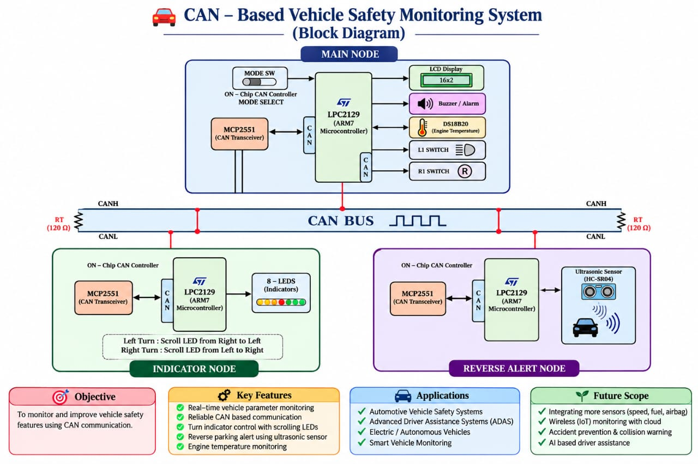
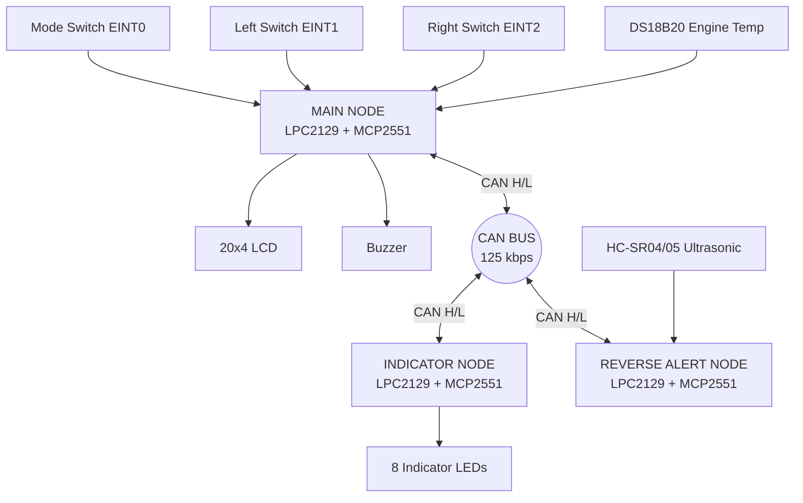
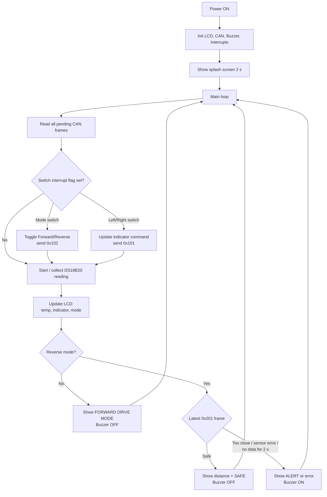
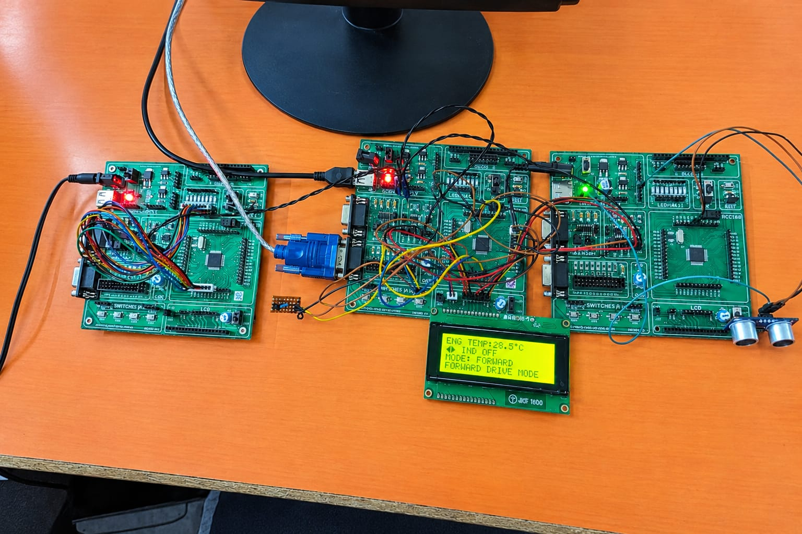
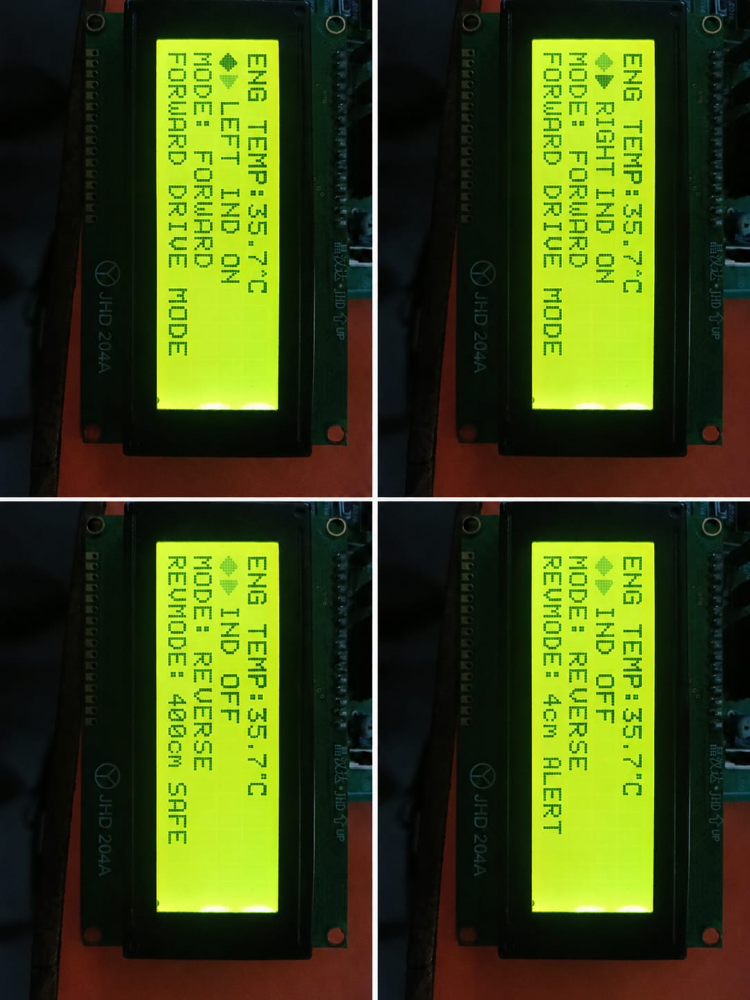

<div align="center">

# 🚗 Multi-Node CAN-Based Vehicle Monitoring & Reverse Safety System


-red?style=for-the-badge)


A three-node embedded system built on the **NXP LPC2129 (ARM7TDMI-S)** that monitors engine temperature, controls vehicle turn indicators, and warns the driver about obstacles during reverse driving. All nodes talk to each other over a **CAN bus** using **MCP2551** transceivers.

</div>

---

## 📖 1. Project Overview / Purpose

### Objective
Modern vehicles are built from many small electronic units (ECUs) that must exchange data reliably. This project demonstrates that idea on a small scale: three independent microcontroller nodes share engine temperature, indicator commands, driving mode, and obstacle distance over a single two-wire CAN bus.

### Problem Addressed
- Drivers have no easy way to see engine temperature and indicator state in one place.
- Reversing with poor visibility is a common cause of low-speed collisions.
- Point-to-point wiring between modules is bulky and unreliable. CAN allows many nodes to share one noise-tolerant bus.

### Scope
- **Main Node** reads engine temperature, shows the vehicle status on an LCD, reads the mode and indicator switches, and raises a buzzer alert in reverse mode.
- **Indicator Node** drives 8 LEDs as scrolling left/right turn indicators, based on commands received over CAN.
- **Reverse Alert Node** measures obstacle distance with an ultrasonic sensor and reports it to the Main Node over CAN.

---

## ✨ 2. Features and Functionality

| Feature | Description |
|---|---|
| **Engine Temperature Monitoring** | DS18B20 (1-Wire) sensor, shown on the LCD with 0.1 °C resolution. Reads without blocking the main loop. |
| **Forward / Reverse Mode** | One mode switch (EINT0). Starts in Forward mode and toggles to Reverse on each press. |
| **Turn Indicators over CAN** | Left (EINT1) and Right (EINT2) switches send a command to the Indicator Node, which scrolls one LED at a time across 8 LEDs. |
| **Ultrasonic Reverse Alert** | In Reverse mode, the Reverse Alert Node measures distance (1–400 cm) and sends it to the Main Node. |
| **Distance Display + Buzzer** | LCD shows `DIST: xxx cm SAFE` or `ALERT`. The buzzer sounds when the obstacle is closer than **20 cm**. |
| **Fault Detection** | Sensor failure (no echo) is reported explicitly as `SENS ERR`. If the Reverse node goes silent for 2 s, the display shows `NO DATA FROM SENSOR` and the buzzer sounds. |
| **Switch Debouncing** | 250 ms hardware-timer-based debounce (Timer1, 1 ms tick) on all three external-interrupt switches. |
| **Median Filtering** | Three ultrasonic readings per cycle, and the median is used so a single bad reading cannot hide an obstacle. |
| **Reliable CAN Layer** | Transmit timeout with retry, and every pending receive frame is read on each pass so no message is lost. |
| **Custom LCD Characters** | Indicator arrows are stored in LCD CGRAM and blink while an indicator is active. |

---

## 📁 3. Repository / Folder Structure

```
multinode-can-reverse-safety-lpc2129/
├── Programs/
│   ├── Main_Node/
│   │   ├── inc/
│   │   │   ├── DEFINES_MAJOR.h          # Bit-manipulation macros
│   │   │   ├── DELAY_MAJOR.h            # Delay (ms/us) interface
│   │   │   ├── DS18B20_MAJOR.h          # DS18B20 1-Wire driver interface
│   │   │   ├── buzzer_major.h           # Buzzer driver interface
│   │   │   ├── can_defines_major.h      # CAN pins, bit timing, register bits
│   │   │   ├── can_major.h              # CAN driver interface
│   │   │   ├── clock_major.h            # CCLK / PCLK definitions
│   │   │   ├── interrupt_major.h        # EINT + Timer1 interface
│   │   │   ├── major_lcd.h              # LCD driver interface
│   │   │   ├── major_lcd_defines.h      # LCD pins + HD44780 commands
│   │   │   └── major_type.h             # Type aliases (u8, u16, u32 ...)
│   │   └── src/
│   │       ├── MAIN_NODE.c              # main(): ties everything together
│   │       ├── Interrupt_MAJOR.c        # EINT0/1/2 ISRs + 1 ms timebase
│   │       ├── buzzer_MAJOR.c
│   │       ├── can_MAJOR.c
│   │       ├── delay_MAJOR.c
│   │       ├── ds18b20_MAJOR.c
│   │       └── lcd_MAJOR.c
│   │
│   ├── Indicator_Node/
│   │   ├── inc/   (CAN, clock, delay, type headers)
│   │   └── src/
│   │       ├── indicator_node.c         # main(): CAN receive + LED scrolling
│   │       ├── can_MAJOR.c
│   │       └── delay_MAJOR.c
│   │
│   └── Reverse_Alert_Node/
│       ├── inc/   (CAN, clock, delay, type, ultrasonic headers)
│       └── src/
│           ├── reverse_node.c           # main(): measure + CAN transmit
│           ├── ultrasonic_major.c       # HC-SR04/05 driver
│           ├── can_MAJOR.c
│           └── delay_MAJOR.c
│
├── docs/
│   └── images/
│       ├── Block_Diagram.jpeg
│       ├── Project_Firmware.jpeg
│       └── Result.jpeg
│
├── .gitignore
├── LICENSE
└── README.md
```

Each node is a **separate Keil project**. Common drivers such as CAN and delay are intentionally duplicated per node so each project builds on its own.

---

## 🧩 4. Block Diagram

<div align="center">



</div>

<details>
<summary>📌 Mermaid version (renders directly on GitHub, click to expand)</summary>



</details>

---

## 📨 4.1 CAN Message Map

Bus speed: **125 kbps**, 11-bit standard identifiers, CAN1 controller of the LPC2129.

| CAN ID | Direction | DLC | Payload |
|---|---|---|---|
| `0x101` | Main → Indicator | 1 | byte0 = `'L'` (left), `'R'` (right), `'S'` (off) |
| `0x102` | Main → Reverse Alert | 1 | byte0 = mode (`0` Forward, `1` Reverse) |
| `0x201` | Reverse Alert → Main | 3 | byte0–1 = distance in cm (little endian), byte2 = alert (`0` safe, `1` closer than 20 cm, `2` sensor error) |

> The Reverse Alert Node only measures and transmits while the vehicle is in **Reverse mode**, which keeps bus traffic low in Forward mode.

---

## 🔄 5. Flow Chart: End-to-End Operation



---

## 🔧 6. Hardware Details

| Component | Purpose | Notes |
|---|---|---|
| **LPC2129 ×3** (ARM7TDMI-S) | One controller per node | Two on-chip CAN controllers (CAN1 used), CCLK = 60 MHz |
| **MCP2551 ×3** | CAN transceiver | One per node, connected to the CAN1 RD1/TD1 pins |
| **120 Ω terminators ×2** | CAN bus termination | One at each end of the bus |
| **20×4 LCD (JHD 204A, HD44780)** | Main node display | 8-bit interface |
| **DS18B20** | Engine temperature | 1-Wire, 12-bit (1/16 °C) |
| **HC-SR04 / HC-SR05** | Obstacle distance | Range 1–400 cm in this firmware |
| **8 LEDs** | Indicator animation | Active-low |
| **Push-buttons ×3** | Mode, Left, Right | Falling-edge external interrupts |
| **Buzzer** | Audible alert | Active-low circuit |
| **USB-to-UART converter** | Programming | Used with Flash Magic |

### Pin Mapping

**Main Node**

| Signal | Pin |
|---|---|
| LCD Data D0–D7 | P0.8 – P0.15 |
| LCD RS / EN / RW | P0.16 / P0.17 / P0.18 |
| DS18B20 data | P0.19 |
| Buzzer (active-low) | P0.20 |
| Mode switch (EINT0) | P0.1 |
| Left switch (EINT1) | P0.3 |
| Right switch (EINT2) | P0.7 |
| CAN1 RD | P0.25 |
| CAN1 TD | Dedicated pin |

**Indicator Node**

| Signal | Pin |
|---|---|
| 8 indicator LEDs (active-low) | P0.0 – P0.7 |
| CAN1 RD / TD | P0.25 / dedicated pin |

**Reverse Alert Node**

| Signal | Pin |
|---|---|
| Ultrasonic Trigger | P0.20 |
| Ultrasonic Echo | P0.19 |
| CAN1 RD / TD | P0.25 / dedicated pin |

### Software Used
- **Embedded C** with the **Keil µVision** compiler
- **Flash Magic** to load the `.hex` file over UART

---

## 📸 7. Hardware Setup & Results

### Hardware Setup

<div align="center">



*Three LPC2129 boards connected on one CAN bus. Left: Indicator Node, center: Main Node with the 20×4 LCD, right: Reverse Alert Node with the ultrasonic sensor.*

</div>

### LCD Output

<div align="center">



</div>

| Screenshot | Meaning |
|---|---|
| Top-left | Forward mode, **left indicator ON**, engine temperature 35.7 °C |
| Top-right | Forward mode, **right indicator ON** |
| Bottom-left | Reverse mode, **obstacle at 400 cm → SAFE** |
| Bottom-right | Reverse mode, **obstacle at 4 cm → ALERT** (buzzer ON) |

---

## ✅ 8. Testing Instructions

### 8.1 Setup
1. Open each node's code as its own Keil µVision project (**Device = LPC2129**) and build it.
2. Flash each `.hex` to its own board with Flash Magic.
3. Wire **CANH to CANH** and **CANL to CANL** across all three MCP2551 transceivers.
4. Place a **120 Ω resistor at each end** of the bus.
5. Make sure all boards share a common ground, then power them up.

### 8.2 Test Cases

| # | Test | Steps | Expected Result |
|---|---|---|---|
| 1 | Boot screen | Power on the Main Node | LCD shows "Vehicle Safety And Monitoring System" for 2 s |
| 2 | Temperature display | Idle | `ENG TEMP:xx.x°C` updates about once per second |
| 3 | Sensor missing | Disconnect DS18B20 | LCD shows `SENSOR FAIL` |
| 4 | Left indicator | Press the Left switch | LCD shows `LEFT IND`; Indicator Node scrolls the LEDs in the left direction |
| 5 | Right indicator | Press the Right switch | LCD shows `RIGHT IND`; LEDs scroll the other way |
| 6 | Indicator off | Press the same switch again | `IND OFF`; all LEDs off |
| 7 | Switch to Reverse | Press the Mode switch | `MODE: REVERSE`, then distance appears after the first CAN frame |
| 8 | Safe distance | Keep an object more than 20 cm away | `DIST:xxx cm SAFE`, buzzer off |
| 9 | Obstacle alert | Bring an object closer than 20 cm | `ALERT`, buzzer ON |
| 10 | Back to Forward | Press the Mode switch again | `FORWARD DRIVE MODE`, buzzer off |
| 11 | CAN link loss | Disconnect the Reverse Node while in Reverse | `NO DATA FROM SENSOR` after 2 s, buzzer ON |
| 12 | Ultrasonic failure | Disconnect the sensor echo wire | `SENS ERR` and buzzer ON |

---

## 🛠️ 9. Troubleshooting Guidelines

| Symptom | Likely Root Cause | Resolution |
|---|---|---|
| Nothing is received on any node | No ACK on the bus, or CANH/CANL swapped | Check CANH/CANL wiring and the common ground. A CAN transmitter needs at least one other working node to ACK its frames. |
| Bus is unstable or errors appear | Missing or extra termination | Use exactly two 120 Ω terminators, one at each end. |
| CAN works on one node but not another | Different clock settings | All nodes must use the same CCLK and PCLK. `clock_major.h` reads PCLK from VPBDIV at run time, so check the Startup PLL setup. |
| Indicator turns off late, or a command is missed | Receive buffer overflow because frames were not read quickly enough | Already handled: all pending frames are read each pass, and the Indicator Node checks CAN every 10 ms. |
| Left/right indicator toggles several times per press | Switch contact bounce | Already handled by the 250 ms Timer1 debounce. Increase `DEBOUNCE_MS` if your switches are worse. |
| Obstacle shows as SAFE when something is very close | A failed reading mixed into an average | Already handled by taking the median of valid readings and reporting failures as `SENS ERR`. |
| Fake ultrasonic readings | Previous echo picked up by the next shot | Keep at least 60 ms between measurements (already done in firmware). |
| Buzzer sounds right after power-up | Active-low buzzer driven low at init | `Buzzer_init()` sets the pin high (OFF) first. Check the buzzer wiring polarity. |
| LCD shows garbled or leftover characters | Old text not overwritten | The firmware writes fixed-width text lines. If you add new text, pad it to the full line width. |
| Temperature shows `--` or `SENSOR FAIL` | DS18B20 not responding | Check P0.19 wiring and the 4.7 kΩ pull-up on the data line. |

---

## 🌍 10. Real-Time Use Cases

- **Automotive safety systems**: the same node-per-function structure is used in real vehicle ECUs.
- **Parking assist / reverse sensors**: ultrasonic distance with a buzzer alert.
- **Advanced Driver Assistance Systems (ADAS)**: a learning platform for multi-sensor CAN designs.
- **Electric and autonomous vehicles**: monitoring subsystems over a shared bus.
- **Industrial CAN networks**: the same bus and message design applies to machines and factory automation.

### Future Scope
- More sensors: speed, fuel level, airbag.
- Wireless (IoT) monitoring with cloud logging.
- Collision warning and accident prevention.
- Over-temperature warning threshold with buzzer.

---

## 🧭 11. Notes for Maintainers

- The CAN message IDs (`0x101`, `0x102`, `0x201`) and the alert distance (`ALERT_DIST_CM = 20`) are defined at the top of `MAIN_NODE.c` and `reverse_node.c`. Change them in both places if you modify the protocol.
- The main loop never blocks for long. The DS18B20 conversion (750 ms) is started and collected later, so CAN is always serviced.
- CAN bit timing is computed in `can_defines_major.h` using 20 time quanta per bit. It works for PCLK of 15, 30 or 60 MHz at 125 kbps.
- If you change CCLK, update `CCLK` in `clock_major.h` and recalibrate the delay routines in `delay_MAJOR.c`.

---

## 🙏 Credits

Project problem statement and training provided by **Vector India**. Firmware developed by **Manthan Nalbilwar**.

## 📄 License

This project is licensed under the MIT License. See the [LICENSE](LICENSE) file.
